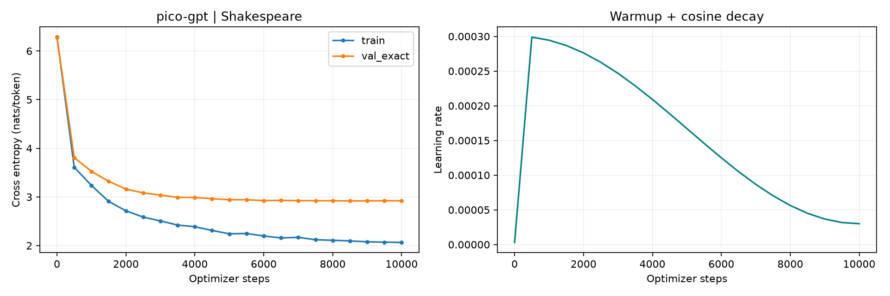

# pico-gpt

A clean, educational GPT-style transformer language model implemented **completely from scratch** in PyTorch — no `nn.Transformer`, no HuggingFace, no `tiktoken`.

Includes a custom byte-level BPE tokenizer, dual attention backends (manual reference + SDPA fast path), KV-cache autoregressive generation, gradient accumulation, exact evaluation, and an automated presentation deck with neural narration.

---



## Highlights

- **From-Scratch Byte-Level BPE Tokenizer** (`picogpt/bpe.py`): Pure Python implementation of byte pair encoding. All 256 raw bytes are always representable, guaranteeing 100% roundtrip fidelity with zero unknown tokens.
- **Dual Attention Backends** (`picogpt/model.py`):
  - `manual`: Explicit matrix multiplications, scaling, causal triangular mask, and softmax for full transparency.
  - `sdpa`: Accelerated FlashAttention-style fast path via `torch.nn.functional.scaled_dot_product_attention`.
  - Mathematically and numerically equivalence-tested to $\le 10^{-5}$.
- **KV-Cache Generation**: Prefill and cached single-token step decoding. Verified token-identical to full-sequence forward passes across sliding context windows.
- **Rigorous Training Pipeline** (`picogpt/train.py`): AdamW optimizer, warmup-to-cosine learning rate schedule, gradient accumulation, gradient norm clipping, and deterministic exact full-corpus evaluation.
- **34 Automated Tests** (`tests/`): Comprehensive test suite covering causal masking, weight tying, parameter counts, initialization sanity ($\approx \ln(\text{vocab})$), training mode restoration, and cache parity.

---

## Empirical Results

Experiments trained on the complete [Tiny Shakespeare](https://raw.githubusercontent.com/karpathy/char-rnn/master/data/tinyshakespeare/input.txt) corpus (1,115,394 characters, 512-vocabulary BPE tokenization, 90/10 train/val split):

| Configuration | Parameters | Batch & Context | Steps | Best Val NLL (nats/token) | Observations |
|---|---:|---:|---:|---:|---|
| **Flagship** (12L / 10H / 640D) | 59,326,080 | 64 batch, 256 ctx | 2,000 (stopped) | 3.0285 @ step 500 | Severe overfitting; memorized training set (train loss 0.128, val loss 5.135) |
| **Balanced** (4L / 4H / 256D, dropout 0.2) | 3,344,640 | 32 batch, 256 ctx | 3,000 | 3.1431 @ step 3000 | Smooth convergence without diverging |
| **Balanced Long** (4L / 4H / 256D, dropout 0.2) | 3,344,640 | 32 batch, 256 ctx | 10,000 | **2.9183** @ step 8500 | **Winner**: lower parameter count generalized significantly better |

> **Key takeaway**: Scale is a hypothesis, not a guarantee. On a 1MB corpus, a 3.3M parameter model with moderate dropout strongly outperforms an over-parameterized 59M model that memorizes training data.

---

## Presentation & Media

- **Slide Deck**: [`pico-gpt-presentation.pptx`](pico-gpt-presentation.pptx) — An 8-slide 16:9 presentation covering architecture, results, test rigor, and lessons learned. Built by `make_deck.py`.

---

## Repository Structure

```
pico-gpt/
├── picogpt/                  # Core library
│   ├── __init__.py           # Package exports
│   ├── bpe.py                # Byte-level BPE tokenizer from scratch
│   ├── data.py               # Character tokenizer & batch sampler
│   ├── model.py              # GPT architecture, attention, KV-cache
│   └── train.py              # Training loop, optimizer, exact evaluation
├── tests/                    # Test suite (34 tests)
│   ├── test_bpe.py           # BPE train, merge, encode, decode tests
│   ├── test_model.py         # Causal mask, KV-cache, SDPA parity tests
│   └── test_train.py         # LR schedule, grad accum, eval tests
├── media/                    # Media assets & generated outputs
│   └── loss_curve.png        # Training/validation loss curves
├── pico-gpt-presentation.pptx# Widescreen presentation deck
├── prepare_bpe.py            # Download corpus & train BPE tokenizer
├── prepare.py                # Legacy character-level data preparation
├── train_script.py           # Main training script (CPU/CUDA)
├── sample.py                 # Text generation CLI with temperature & top-k
├── report.py                 # Generate loss curves & sample summaries
├── make_deck.py              # Programmatically builds presentation deck
├── pyproject.toml            # Package configuration & dependencies
├── LICENSE                   # MIT License
└── README.md
```

---

## Quickstart

### 1. Installation

Python 3.10+ is required. Clone the repository and install dependencies:

```bash
git clone https://github.com/ZeroTrustZein/pico-gpt.git
cd pico-gpt
pip install -e .
```

To install testing and deck generation utilities:

```bash
pip install -e ".[dev,media]"
```

### 2. Run the Test Suite

Verify all 34 architectural, mathematical, and integration tests:

```bash
pytest
```

### 3. Generate Samples from a Trained Checkpoint

```bash
python sample.py \
  --ckpt out_balanced_long/ckpt.pt \
  --tokenizer data_clean/tokenizer_bpe.json \
  --prompt "ROMEO:" \
  --tokens 250 \
  --temperature 0.8 \
  --top-k 20
```

Sample output:
```
ROMEO: the duke is the worst. Look, how he hath done?

CAPULET:
Well, what, what?

Nurse:
Pompey; nurse, good Peter, perchance will go with me.
This is the matter, madam.
```

### 4. Training from Scratch

Prepare the BPE dataset:
```bash
python prepare_bpe.py --vocab-size 512 --out data_clean
```

Launch training (CUDA GPU or CPU):
```bash
python train_script.py \
  --data data_clean/corpus_bpe.pt \
  --out out_run \
  --iters 10000 \
  --batch-size 32 \
  --block-size 256 \
  --n-layer 4 \
  --n-head 4 \
  --n-embd 256 \
  --dropout 0.2 \
  --lr 3e-4 \
  --eval-interval 500
```

Generate metrics report and loss curves:
```bash
python report.py --out out_run --tokenizer data_clean/tokenizer_bpe.json
```

### 5. Build Presentation & Videos

Rebuild the 16:9 PowerPoint deck from current artifacts:
```bash
python make_deck.py
```

Rebuild presentation videos:
```bash
python make_videos.py --option all
```

---

## Verification & Architecture Guarantees

Every claim in this repository is guarded by unit tests in `tests/`:

1. **Causal Masking**: Perturbing future tokens produces bit-identical logits for earlier positions.
2. **SDPA Parity**: `F.scaled_dot_product_attention` matches manual multi-head attention to $\le 10^{-5}$.
3. **KV-Cache Integrity**: Step-by-step cached decoding matches full-prefix forward passes over 240+ sampled tokens across window shifts.
4. **Initialization Sanity**: Loss at iteration 0 sits within $0.15$ of theoretical cross-entropy $\ln(\text{vocab})$.
5. **Exact Evaluation Determinism**: Disjoint evaluation windows guarantee stable, weighted loss metrics without Monte Carlo variance.
6. **Training Mode State**: Evaluation hooks verify dropout is cleanly re-enabled after validation sweeps.

---

## Limitations

- **Small Data & Model**: Trained exclusively on Tiny Shakespeare (~1.1 MB). The model captures grammar, cadence, and dialogue structure, but does not generalize to factual reasoning.
- **Context Length**: Limited to 256 BPE tokens (~500 characters).
- **Educational Scope**: Built for clarity, transparency, and self-contained experimentation rather than commercial deployment.

---

## License

MIT License. See [LICENSE](LICENSE) for details.
